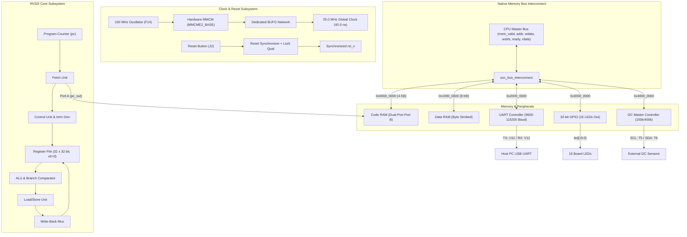

# Custom RV32I SoC Architecture Specification

## 1. Overview
The Custom RV32I SoC is a synthesizable System-on-Chip designed for the **Real Digital Boolean Board** featuring the **AMD/Xilinx Spartan-7 FPGA (`xc7s50csga324-1`)**. The architecture integrates a full-featured, single-cycle/multi-cycle stall custom RV32I CPU core with a PicoRV32-compatible native memory bus, tightly-coupled memories, and memory-mapped I/O (MMIO) peripherals.

---

## 2. Processor Core (`risc_core`)

### 2.1 Instruction Set Architecture (RV32I Base)
The core implements the complete non-privileged RISC-V 32-bit integer ISA:

1. **R-type Arithmetic & Logical Instructions**:
   - `ADD`, `SUB`, `AND`, `OR`, `XOR`, `SLL`, `SRL`, `SRA`, `SLT`, `SLTU`
   - Complete 32-bit signed and unsigned operations with full arithmetic and logical shift support.

2. **I-type Immediate Arithmetic & Logical Instructions**:
   - `ADDI`, `SLTI`, `SLTIU`, `XORI`, `ORI`, `ANDI`, `SLLI`, `SRLI`, `SRAI`
   - Correct sign-extension for 12-bit immediates, and shift amounts using `imm[4:0]`.

3. **Load Instructions**:
   - `LB` (sign-extended byte), `LBU` (zero-extended byte)
   - `LH` (sign-extended halfword), `LHU` (zero-extended halfword)
   - `LW` (full 32-bit word)
   - Alignment: Addressed using byte offset `ALU_result[1:0]` with lane extraction.

4. **Store Instructions**:
   - `SB` (store byte with 1-hot `mem_wstrb` according to `ALU_result[1:0]`)
   - `SH` (store halfword with 2-hot `mem_wstrb` and lane alignment)
   - `SW` (store 32-bit word with `mem_wstrb = 4'b1111`)
   - Preserves unaffected bytes during partial writes.

5. **Conditional Branch Instructions**:
   - `BEQ`, `BNE`, `BLT` (signed), `BGE` (signed), `BLTU` (unsigned), `BGEU` (unsigned)
   - Branch target: `PC + B-type immediate`
   - `branch_comparator` operates in parallel with the ALU to evaluate branch condition without delay.

6. **Control Transfer / Jumps**:
   - `JAL`: Unconditional jump to `PC + J-immediate`, writing return address (`PC + 4`) to `rd`.
   - `JALR`: Indirect jump to `(rs1 + I-immediate) & ~32'd1` (clearing bit 0 per RISC-V specification), writing return address (`PC + 4`) to `rd`.

7. **Upper-Immediate Instructions**:
   - `LUI`: Load Upper Immediate (`rd = imm[31:12] << 12`).
   - `AUIPC`: Add Upper Immediate to PC (`rd = PC + (imm[31:12] << 12)`).

### 2.2 Execution Timing & Bus Handshake
- **ALU, Branch, Jump, and Upper-Immediate Operations**: Execute in a single clock cycle when `clk_en` is high.
- **Load and Store Operations**: Execute over the native PicoRV32 memory bus. The core asserts `mem_valid` and asserts internal `stall = mem_valid & !mem_ready`. When the slave asserts `mem_ready` (typically on the next clock cycle), the core captures data (for loads) or confirms completion (for stores) and unstalls.

---

## 3. Bus Architecture & Interconnect

The SoC adopts the native memory bus protocol popularized by the PicoRV32 architecture:

### 3.1 Bus Signal Definitions
| Signal | Direction (Master perspective) | Width | Description |
| :--- | :--- | :--- | :--- |
| `mem_valid` | Output | 1 bit | Transaction request; held high until `mem_ready` is asserted. |
| `mem_instr` | Output | 1 bit | `1` for instruction fetch, `0` for data read/write. |
| `mem_addr`  | Output | 32 bits | Byte address of the transfer. |
| `mem_wdata` | Output | 32 bits | Write data aligned to 32-bit word boundary. |
| `mem_wstrb` | Output | 4 bits | Byte write enable strobes (`0000` for reads). |
| `mem_ready` | Input | 1 bit | Acknowledgment from slave that data is valid or write is complete. |
| `mem_rdata` | Input | 32 bits | Read data from slave. |

### 3.2 Interconnect Features
- **Deterministic 1-Wait-State Slaves**: All synchronous BRAM and MMIO peripherals respond with `ready` after 1 cycle.
- **Unmapped Address Protection**: If an address outside all valid regions is accessed, the interconnect responds on the next cycle with `mem_ready = 1` and `mem_rdata = 32'hDEADBEEF`, preventing CPU deadlock.
- **Zero Combinational Feedback**: By using registered `mem_ready` responses, combinational loops between peripheral status, ALU result, and PC stall are completely eliminated.

---

## 4. Clocking and Power Distribution

- **Input Clock**: 100 MHz single-ended LVCMOS33 clock from crystal oscillator on pin `F14`.
- **Operating Rate**: The SoC uses a synchronous clock enable `soc_clk_en` pulsed every 4 cycles of the 100 MHz clock to provide an effective 25 MHz execution rate.
- **Advantages of Clock Enable**:
  - Avoids low-skew clock network routing limitations on Spartan-7.
  - Keeps all registers in the exact same 100 MHz clock domain, eliminating clock domain crossing (CDC) issues.
  - Allows UART baud rate generators and I2C phase timing to reference the full 100 MHz resolution (10 ns ticks) for maximum baud rate accuracy.
